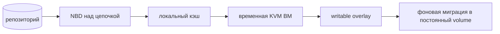

# Восстановление: реализация и границы

Документ отделяет уже работающий путь восстановления от следующих этапов.
Функция считается готовой к production не только после появления API: для неё
нужен регулярный приёмочный прогон на копии реальной инфраструктуры.

## Что реализовано

### Восстановление данных

- образ диска собирается из полной, инкрементальной или разностной цепочки;
- результат можно записать в разрешённый каталог сервера, новый диск oVirt или
  поверх существующего диска с явным подтверждением;
- для чтения можно выбрать физическую копию; вся цепочка берётся из одного
  хранилища и не смешивается между репозиториями;
- отдельный restore run создаётся до фоновой операции и хранит фазу, прогресс,
  итог, ошибку и путь результата.

### Новая ВМ одним действием

Поддерживаются совместимые направления **oVirt→oVirt** и **KVM→KVM**.

**Proxmox→Proxmox** реализован отдельным нативным путём: поток `vzdump`
восстанавливается через `qmrestore` или `pct restore` на выбранном узле.
Переносимый профиль и сопоставления дисков oVirt/KVM к нему не применяются.
Полный живой цикл QEMU/LXC пока требует приёмки — [LIMITATIONS.md](LIMITATIONS.md).

1. Preview читает сохранённый переносимый профиль и реальные ресурсы цели:
   кластеры, storage domains/pools, сети и vNIC profiles. До запуска проверяются
   конфликт имени, свободное место, архитектура и обязательные сопоставления.
2. Профиль версии 2 переносит CPU, память, архитектуру, firmware, Secure Boot,
   диски, шины, порядок загрузки и описание NIC. Исходные UUID, пути к дискам,
   NVRAM и MAC не проигрываются напрямую.
3. Каждый NIC можно исключить либо сопоставить с vNIC profile oVirt,
   libvirt network или bridge. По умолчанию интерфейсы отсоединены, а MAC
   создаются заново.
4. Запуск ВМ является отдельным выбором. Копия типа `config` создаёт ВМ без
   дисков, предупреждает об отсутствии данных и не допускает автозапуск.
5. При ошибке исполнитель идемпотентно удаляет созданные диски/volumes и ВМ.
   Если очистка не завершилась, restore run перечисляет оставшиеся ресурсы.

oVirt использует `CreateVM`, ImageIO и подключение новых дисков. KVM создаёт
storage volumes, безопасный domain XML, выполняет define/start и обратную
очистку через libvirt. Межплатформенная конвертация намеренно не маскируется под
обычное восстановление: **oVirt↔KVM пока не поддерживается**.

### Проверка до аварии

Восемь режимов проверки покрывают наличие объектов, цепочку, checksum,
структуру диска, сборку образа, `qemu-img check`, сверку с источником и пробный
запуск. Режим `boot` создаёт изолированную ВМ без сети на KVM либо, для копии
oVirt, в выбранном Engine и ждёт гостевого агента. KVM использует transient-домен;
Engine — восстановление отдельной ВМ с последующим удалением ВМ и дисков.
Явные `keep_on_failure`/`keep_on_success` могут оставить проверочную ВМ
для диагностики; она продолжает занимать место до ручной очистки.
Это проверка загружаемости; мгновенного запуска production-нагрузки нет.
Нативный Proxmox проверяется восстановлением и запуском QEMU/LXC отдельно.

## Что ещё требует приёмки

Автоматические unit-тесты проверяют построение плана, совместимость профилей и
часть ошибок. Перед стабилизационным релизом остаётся прогнать на стендах:

- oVirt→oVirt и KVM→KVM для BIOS, UEFI и Secure Boot;
- многодисковые ВМ с разными шинами и порядком загрузки;
- все варианты NIC mapping, start/no-start и конфликт имени;
- `config`-точку без дисков;
- отмену и ошибку на каждой фазе с проверкой rollback и списка остатков;
- восстановление из основной копии и полной реплики при недоступном primary.

## Отдельные возможности и будущие этапы

### Мгновенный запуск из копии

Этой функции ещё нет. Обычный restore и проверка `boot` сначала собирают диски.
Для запуска KVM прямо из репозитория нужен отдельный NBD-сервер над цепочкой,
локальный кэш чанков, writable overlay и фоновый перенос в постоянное хранилище.

Начинать следует с KVM: libvirt умеет подключить NBD-источник. oVirt не даёт
присоединить внешний NBD как обычный диск ВМ, поэтому его поддержка потребует
другой архитектуры.

### Согласованность с приложением

Первый этап реализован: задание заявляет уровень `crash`, `filesystem` или
`application`, запуск хранит достигнутый уровень и причину понижения, а
неудачная заморозка либо прерывает запуск до начала бэкапа, либо поднимает
оповещение `backup_consistency_degraded`. Уровень `application` обеспечивают
именованные сценарии внутри гостя (`deploy/guest-hooks`) через штатный
механизм `fsfreeze-hook` агента, а не произвольная команда из web. Подробности —
в [OPERATIONS.md](OPERATIONS.md#согласованность-копий-субд).

Второй этап — логические дампы СУБД — тоже реализован отдельным типом
заданий: forced command `jhvirt-db-dump` на хосте СУБД по образцу Proxmox,
поток `pg_dump`/`mysqldump` в общий формат хранения, восстановление только в
новую базу ([OPERATIONS.md](OPERATIONS.md#логические-дампы-субд)).

### Агент на гипервизорах

Сервис остаётся безагентным. Host agent для метрик, локального управления и
восстановления при недоступном Engine не реализован. Если этот этап будет
принят, первая версия должна быть только наблюдающей, работать через исходящее
соединение и иметь версионированный протокол. Управление хостом добавляется
отдельно через те же разрешения, cooldown, лимиты и dry-run, что и действующее
авто-восстановление.

## Граница стабилизационного релиза

Восстановление дисков/файлов и создание новой ВМ внутри одной платформы уже
реализованы; готовность для конкретной площадки подтверждается стендовой
приёмкой. Логические дампы СУБД также реализованы как отдельный тип заданий
и требуют своего dump/restore-прогона. Мгновенный запуск, host agent и
межплатформенная конвертация не реализованы.
